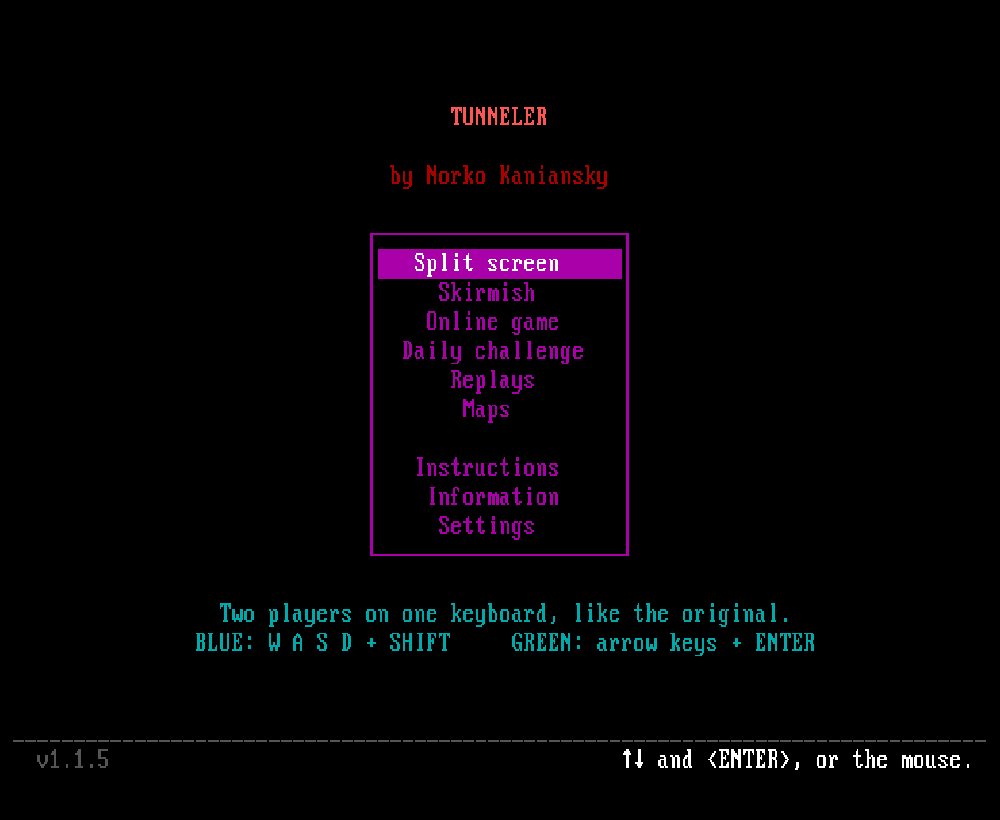
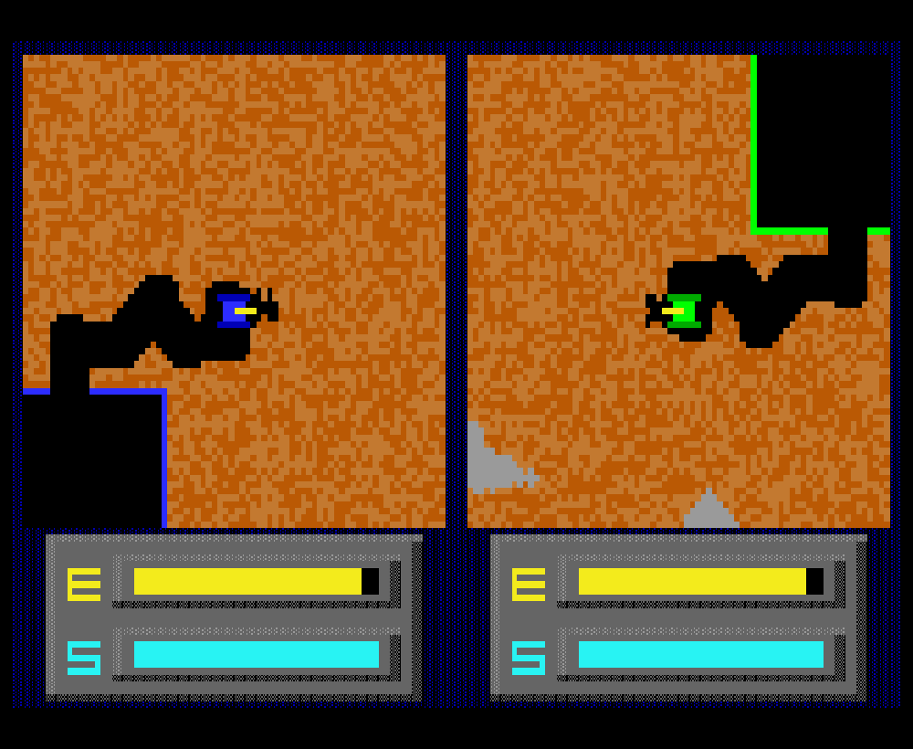
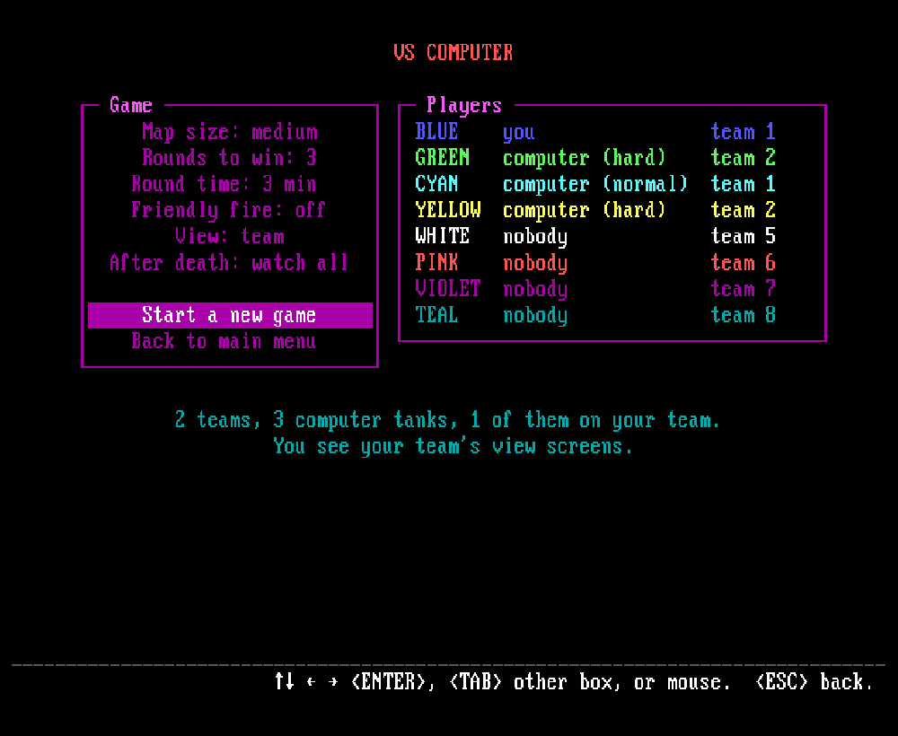
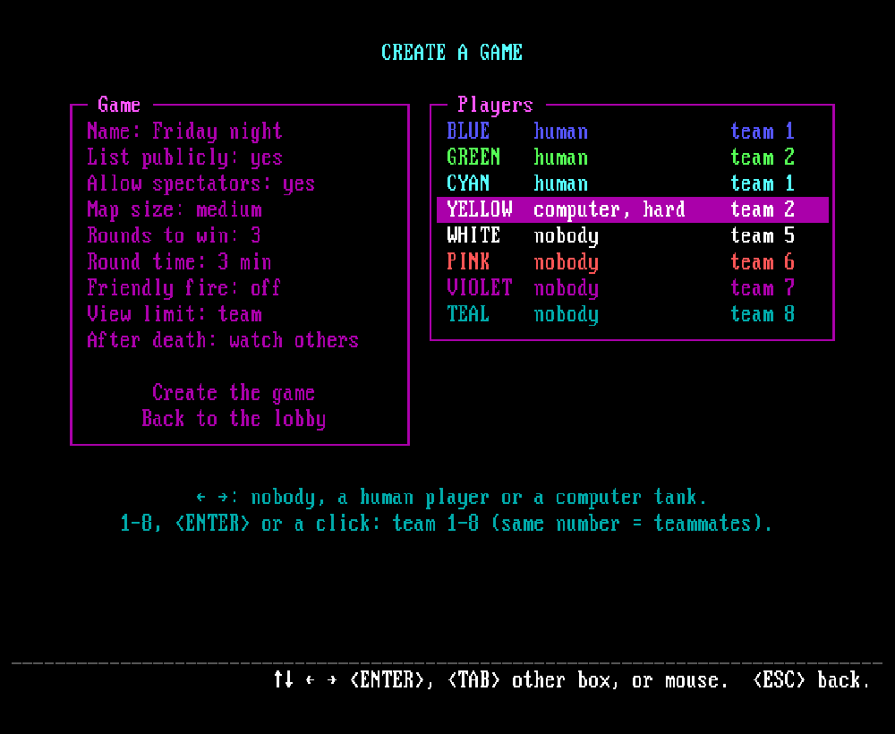
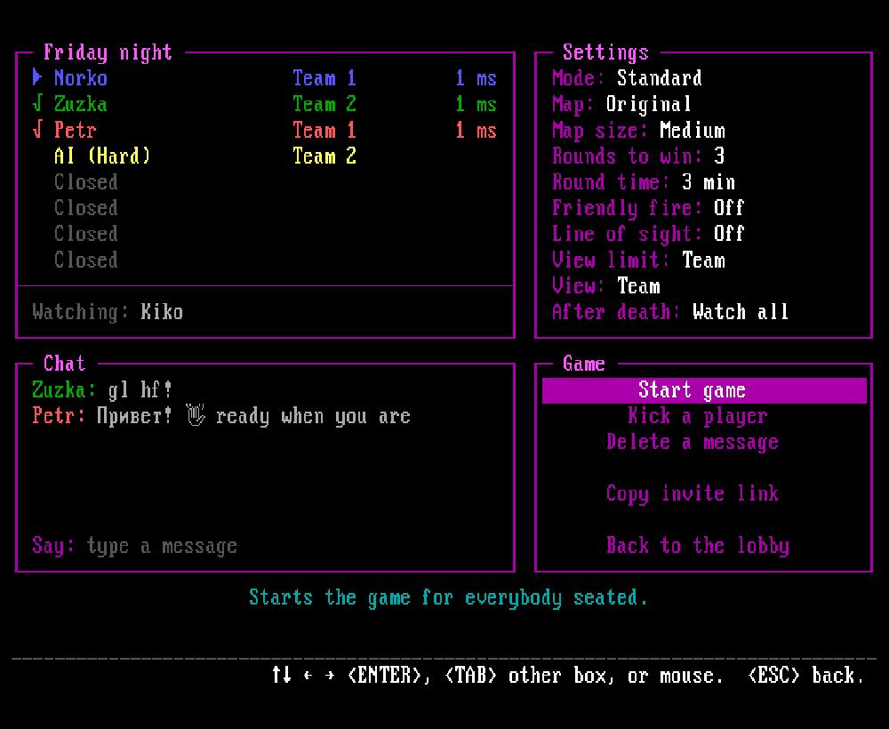
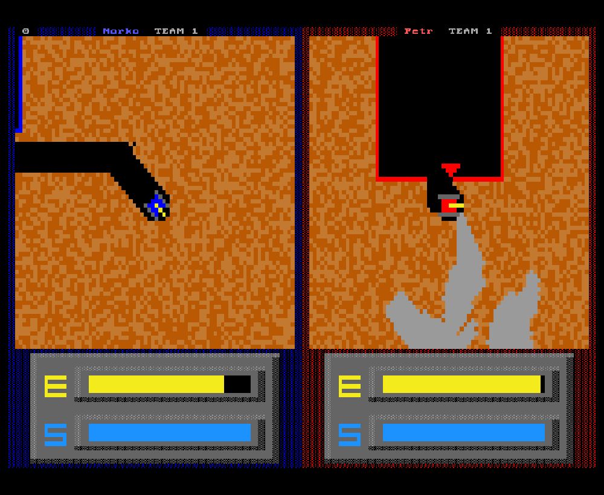
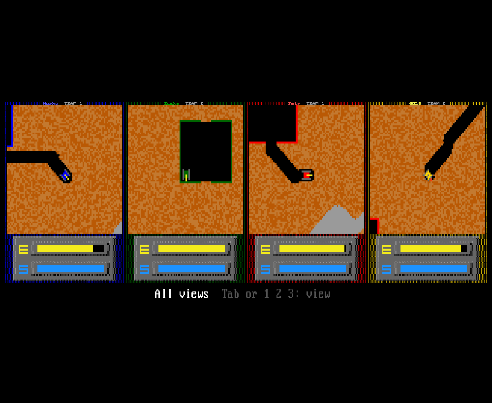
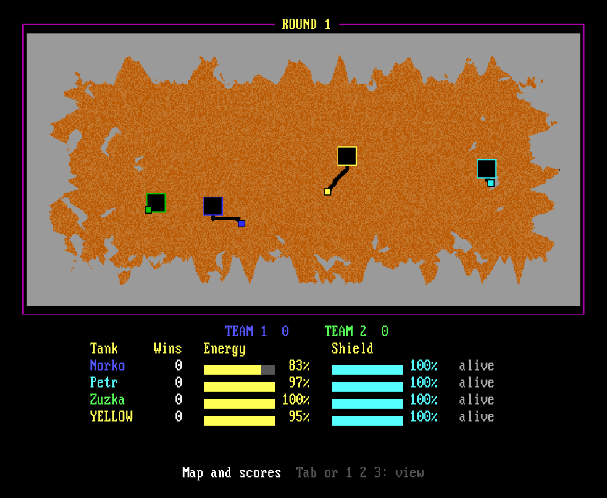
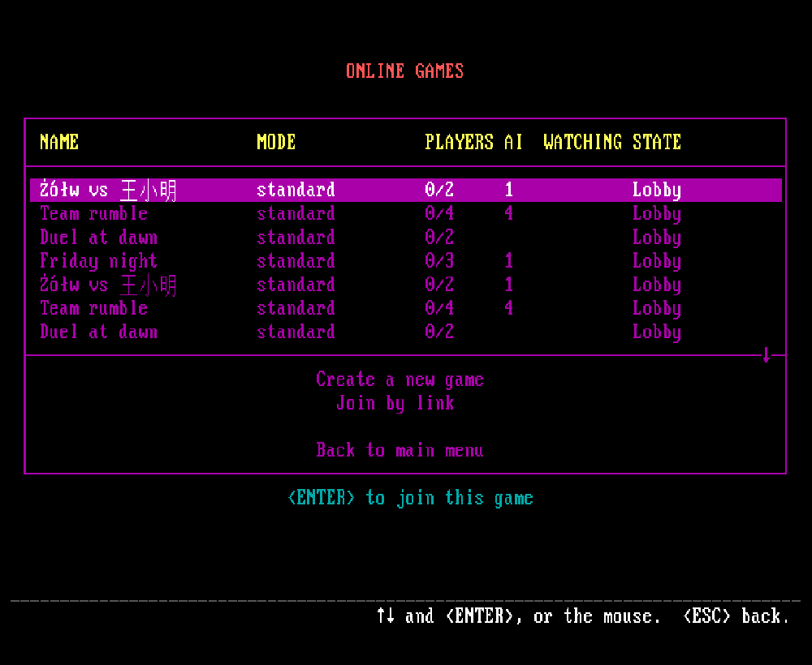

# Tunneler Online

**TUNNELER 2.0** - the 1991 DOS two-player tank game by Geoffrey Silverton - rewritten in JavaScript from
the decompiled original and playable in the browser: split screen, against computer tanks, or online with
up to 8 tanks, in teams, with spectators.

**Play it now: <https://tunneler-online.onrender.com/>** - no install, just a browser. (Hosted on
Render's free tier: if nobody has played for a while, the first visit can take up to a minute while the
server wakes up.)



## Same game, same look

The original program was decompiled and ported routine by routine (`src/js/engine.js`). Tanks, digging,
shots, explosions, energy and shield, sound and the world generator behave exactly like the DOS game - an
automated test runs the original (compiled to WebAssembly) next to the port and compares every frame.
Two tanks (BLUE and GREEN) on the medium map, three rounds to win, is the original game byte for byte;
everything with more tanks, teams or other settings is built on top of it with the same physics.

The screen is the original's undocumented "low-res" text mode (160x100 pixels in 16 colors, made of
80x100 text cells) on an emulated VGA with the IBM ROM font, and the sound is a simulated PC speaker.
All menus, the lobby and the status lines use the same DOS text screen.

| Split screen | Skirmish: the slot editor |
|---|---|
|  |  |

## Modes

- **Split screen** - two players on one keyboard, like the original.
- **Skirmish** - you (in any color) against 1 to 7 computer tanks (easy, medium or hard),
  every tank for itself or in teams. See your own screen, your team's screens or everybody's.
- **Online game** - create a game (public or private, with or without spectators), send the invite
  link (`/game/<name>`), and play with 2 to 8 tanks from several computers; any seat can be an AI tank.
  Addresses: `/games` (the list), `/game/<name>` (the game's lobby), `/game/<name>/watch` (spectating),
  `/split`, `/skirmish`.

Game modes (skirmish and online; every mode's AI plays it too):

- **Standard** - the last tank (or team) still standing wins the round, as in the original.
- **Gold rush** - gold nuggets lie in the dirt: dig them up and bring them to your base; a hit makes you
  drop one. The most gold wins the round.
- **Infection** - one tank starts infected; tanks it destroys come back infected on its side. The healthy
  tanks win if any of them lasts until the time is up.
- **Survival** - all players together against waves of AI tanks that grow with every wave.
- **King of the hill** - hold the zone in the middle of the map alone to fill your bar.
- **Shrinking world** - the safe area closes in; outside it your shield melts away.
- **Capture the flag** - bring the enemy's flag to your base while yours is at home.
- **Base siege** - shoot the enemy bases down; the last side with a base wins.
- **Deathmatch** - destroyed tanks come back at their base; the first side to 10 kills wins.

Every mode but standard and shrinking world is a single round with its own goal instead of "rounds to
win": gold to win, minutes to survive, waves to win, seconds in the zone, captures, base strength (hits),
kills to win. A modifier for any mode: **no base repairs** (bases refuel but don't repair shields).

Settings (split screen: map size, rounds to win and round time only):

- **Slots and teams** - 8 slots (BLUE, GREEN, CYAN, YELLOW, WHITE, PINK, VIOLET, TEAL), each nobody,
  human or a computer tank (online: open, closed or AI), each with a team number 1-8: all different =
  free-for-all, shared numbers = teams of any size (4 v 4, 2 v 2 v 2 v 2, 3 v 5, ...).
- **Map size** - small (512x256), medium (1024x512, the original) or large (2048x1024).
- **Rounds to win** - 1 to 9 (the original: 3).
- **Round time limit** - off, 2, 3, 5 or 10 minutes. When the time is up, the side that hit enemy tanks
  the most wins the round (a tie: nobody); the last 30 seconds count down next to the instrument panel.
- **Friendly fire** - on or off in team games (off: a shot at a teammate explodes like on a wall).
- **View limit** - the most a player may see during play: their own view, their team's or everybody's.
- **After death** - what you see once your tank is destroyed, until the round ends: a black DESTROYED
  screen, your wreck (the original), all your teammates still alive, the tank that destroyed you (then
  its killer, ...) or every tank still alive; nobody left to watch - black. Except with "my wreck", a
  destroyed teammate's view goes black too.

The homepage's **Settings** screen holds your name for online games, the language, the **sound** - muted, original (the PC speaker),
realistic or cartoony (a sample plays when you change it) - and **Show ping** (your round-trip time as
a small number on the game's border online). Sounds of other tanks fade with their distance from the
tank you watch and come from their side, in stereo (split screen: left near BLUE, right near GREEN).

| Create a game | The game's lobby: seats, teams, settings, chat |
|---|---|
|  |  |

### Online

Online play needs a name - asked the first time, changed any time on the Settings screen. Every game
has a **lobby** with 8 seats, one per color, each row in its color: a player's name (a √ in front once
ready), **open**, **closed** or **AI** (easy, medium, hard), the team and the ping. Joining a game takes
a free open seat (else you watch); sit on another open seat to play that color, change your team with
Left / Right, 1-8 or a click, chat with players and spectators (any alphabet), choose **I am ready!**
or **Watch instead**. The creator of the game is its **host** (when the host leaves, the next player
takes over): they set every free seat open, closed or AI (Left / Right or a right click) and its team, change
the game's settings, **Kick a player** (who then can't come back) and **Start game** once everybody
seated is ready. Open seats nobody took get no tank. During a match only its players play - whoever
joins then watches; afterwards everyone is back in the lobby, with the statistics of the last match.
The list of games shows each game's mode, players, AI tanks, spectators and state; Enter joins, Right or
a right click watches. Games you host come first (your private ones too).
A private game is joined with its invite link: open it, or paste it into **Join by link** on the
list of games (the desktop app then also switches to that link's server). Only the same version of the
game plays together: a page or desktop app of another version than the
server's can't join or create games there (it says which versions differ).

During play each player sees only their own view screen - or their team's or everybody's, as far as the
game's view limit allows. A disconnected player's tank stands still and the game goes on;
reconnecting resumes where you left off. (A classic BLUE vs GREEN game pauses instead, like before.)

| An 8-tank game: BLUE sees its team | Spectator: all views | Spectator: map and scores |
|---|---|---|
|  |  |  |

**Spectators** switch between three views with Tab or 1 2 3: all view screens in a grid, the live map of
the whole world with a score table (wins, energy, shield per tank and team), or one tank followed large
(Left / Right choose the tank).



Languages: English, Slovenčina, Čeština, Українська, Русский and Gen Z (on the Settings screen, or
`?lang=sk` / `cs` / `uk` / `ru` / `genz` / `en` in the address). Each language is one file in `src/lang/`.
The homepage, https://kaniansky.com/tunneler/, comes in the same languages.

## Controls

| | BLUE | GREEN |
|---|---|---|
| Move | W A S D | arrow keys |
| Fire | Left Shift, Space | Enter, Right Shift |

Online and against the computer you can use either set. Hold two direction keys to move diagonally;
firing while moving digs faster. **Esc** ends the match on one computer; online, **Esc twice** leaves the
game (one player can't end it for everybody). Menus: arrow keys and Enter, number keys 1-8 for teams, or
the mouse (clicks, the wheel in long lists); Esc goes back.

**Gamepads** work too: the left stick or the d-pad drives the tank in 8 directions, A / B / X / Y, the
shoulder buttons and the triggers fire, Start is Esc. In split screen the first gamepad is BLUE and the
second GREEN (the keyboard still works); against the computer and online any gamepad drives your tank.
In menus the d-pad moves, A selects, B goes back.

**Phones and tablets**: touch the screen and an on-screen joystick (left) and a FIRE button (right)
appear, plus an ESC button; they drive your tank (BLUE in split screen). Tap menu items to choose them.
The game fits the screen in portrait and landscape.

The rules are in the game's own *Instructions* page: win the set number of rounds (three in the
original); a round ends when only one tank (or one team) is left - tanks blow up when shot or out of
energy; refuel at any base, repair your shield at your own (and, at half the speed, at a teammate's).

## Run it

```bash
npm install
npm run build      # src/ -> public/ (minified)
npm start          # http://localhost:8050  (PORT=... to change)
```

`npm run watch` rebuilds on every change and restarts the server. `npm test` runs all the checks.

### Desktop app

Every [release](https://github.com/kaniansky/tunneler-online/releases) has a small desktop app: the game
in its own window, using the web view the system already has (a few MB, no browser needed).

| System | File | Needs |
|---|---|---|
| Windows 10 / 11 | `-windows-x64-setup.exe` (installer) or `tunneler-online-<version>-windows-x64.exe` (just run it) | WebView2 (built in) |
| Linux | `tunneler-online-linux-x64.AppImage` (`chmod +x` first; always the newest: <https://github.com/kaniansky/tunneler-online/releases/latest/download/tunneler-online-linux-x64.AppImage>), `.deb`, `.rpm` (or the repositories below), or the bare binary in `-linux-x64.tar.gz` | `libwebkit2gtk-4.1` |
| macOS | `-macos-arm64.dmg` (Apple silicon) / `-macos-x64.dmg` (Intel) | not signed: right click -> Open the first time |

When a newer release is out, the app's main menu shows **Update to version X**: the installed Windows
app, the AppImage and the macOS app download it, install it and restart; the `.deb` / `.rpm` do the same
after asking for the admin password; the portable exe and the `.tar.gz` show **New version X**, which
opens the download page. A downloaded AppImage has to be made executable once (`chmod +x
tunneler-online-linux-x64.AppImage`, or Properties -> Allow executing as a program) - browsers never keep
that. Its name has no version: an update writes the new version over the same file, so shortcuts keep
working (the main menu's bottom-left corner shows the version).

On Linux the game can also come from its own **apt / dnf repository** and then updates with the rest of
the system (signed with the key at <https://kaniansky.com/tunneler/tunneler-online.asc>):

```bash
# Debian, Ubuntu, Mint
curl -fsSL https://kaniansky.com/tunneler/tunneler-online.gpg | sudo tee /usr/share/keyrings/tunneler-online.gpg >/dev/null
echo "deb [signed-by=/usr/share/keyrings/tunneler-online.gpg] https://kaniansky.com/tunneler/apt ./" | sudo tee /etc/apt/sources.list.d/tunneler-online.list
sudo apt update && sudo apt install tunneler-online

# Fedora and other dnf systems
sudo curl -fsSL -o /etc/yum.repos.d/tunneler-online.repo https://kaniansky.com/tunneler/rpm/tunneler-online.repo
sudo dnf install tunneler-online
```

Split screen and skirmish work offline. Online play goes to the public server; to play on your own,
set **Server** on the homepage's Settings screen (e.g. `example.com:8050`, empty = the public one). The
app is built by `.github/workflows/app-build.yml` from `src-tauri/` ([Tauri](https://tauri.app)); to
build it yourself: install Rust and the [Tauri prerequisites](https://tauri.app/start/prerequisites/),
then `npm run build && npx @tauri-apps/cli@2 build`.

### Hosting

The live version at <https://tunneler-online.onrender.com/> runs this repo's `Dockerfile` on
[Render](https://render.com) as a web service (port 8050, HTTPS and websockets handled by Render). Any
host that runs a Docker image or `npm run build && npm start` and allows websockets works the same way.
Games live in the server's memory, so a restart ends running games.

### Docker

The easiest way is Docker Compose with the published image (`docker-compose.yml` in this repo):

```bash
docker compose up -d                            # http://localhost:8050
TUNNELER_PORT=80 docker compose up -d           # another port on the host
docker compose pull && docker compose up -d     # update to the latest release
docker compose up -d --build                    # build from this checkout instead
```

Or plain Docker:

```bash
docker run -d -p 8050:8050 --restart unless-stopped ghcr.io/kaniansky/tunneler-online:latest
docker build -t tunneler-online . && docker run -d -p 8050:8050 tunneler-online   # from source
```

Games live in the server's memory (a restart ends running games); a game nobody plays in for 10 minutes
is closed automatically.

The server checks GitHub for a newer release when it starts and once a day, and logs a line when one is
out (`UPDATE_CHECK=0` turns that off; nothing is downloaded).

Every release (a pushed version tag) publishes the Docker image to `ghcr.io/kaniansky/tunneler-online`
(`latest` and the version; see `.github/workflows/release.yml`).
Put a reverse proxy (nginx, Caddy, ...) in front for HTTPS; the game connects its websocket over `wss:`
automatically when the page is served over HTTPS.

## How it works

- `src/js/engine.js` - the game: the whole DOS program as a deterministic state machine; one `step()` is
  one BIOS timer tick (54.9 ms, one game frame). The classic two-tank game runs the original code paths
  unchanged; 3-8 tanks, teams and the other settings run the engine's *extended mode* (design:
  [docs/DESIGN-8P.md](docs/DESIGN-8P.md)).
- `src/js/display.js`, `vgafont.js`, `speaker.js`, `input.js`, `runner.js` - emulated VGA text screen,
  PC speaker (sounds fade with distance), keyboard, presentation loop.
- `src/js/dosui.js`, `statusline.js`, `home.js`, `lobby.js` - DOS-style menus, slot editors and status
  lines.
- `src/js/views.js` - what a viewer sees during play: one view screen, a grid of several, or the live
  map with scores.
- `src/js/lang.js` (core), `src/lang/<code>/` (one folder per language: `main.js`, a file per game mode in `modes/`, and
  `en/engine.js` the engine's English text; all joined into `/js/langs.js`),
  `glyphs.js` - translations; letters the VGA font lacks are loaded from a VGA-style console font into
  unused font slots, and names and chat in the lobby are drawn in any alphabet.
- `src/js/ai.js` - the computer tanks: deterministic, so every browser runs the same ones.
- `server.js`, `src/js/netproto.js`, `src/js/online.js` - online play: the server runs the game clock and
  broadcasts every player's keys each tick; every match is its own game (new seed, the lobby's tanks,
  names and settings); every browser runs the same engine and computer tanks (lockstep), so only key
  presses travel over the network.

More detail for contributors in [CONTRIBUTING.md](CONTRIBUTING.md) and [CLAUDE.md](CLAUDE.md).

## Credits

TUNNELER 2.0 (1991) by Geoffrey Silverton, released by him into the public domain. Tunneler Online by
Norko Kaniansky, 2026 - also public domain ([Unlicense](LICENSE)). The fonts and glyph data come from
third parties under their own licenses: see [NOTICE](NOTICE).
