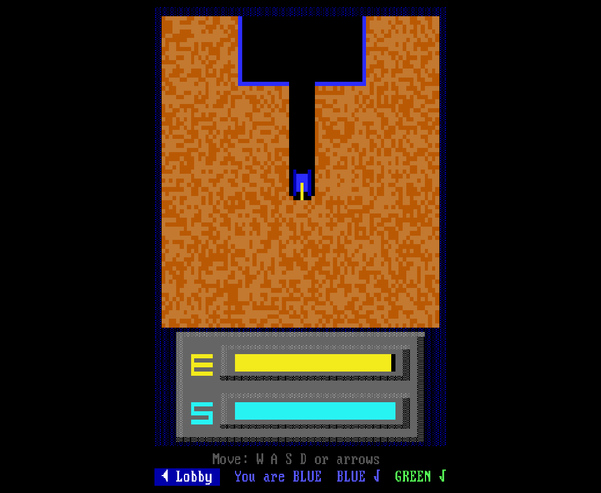
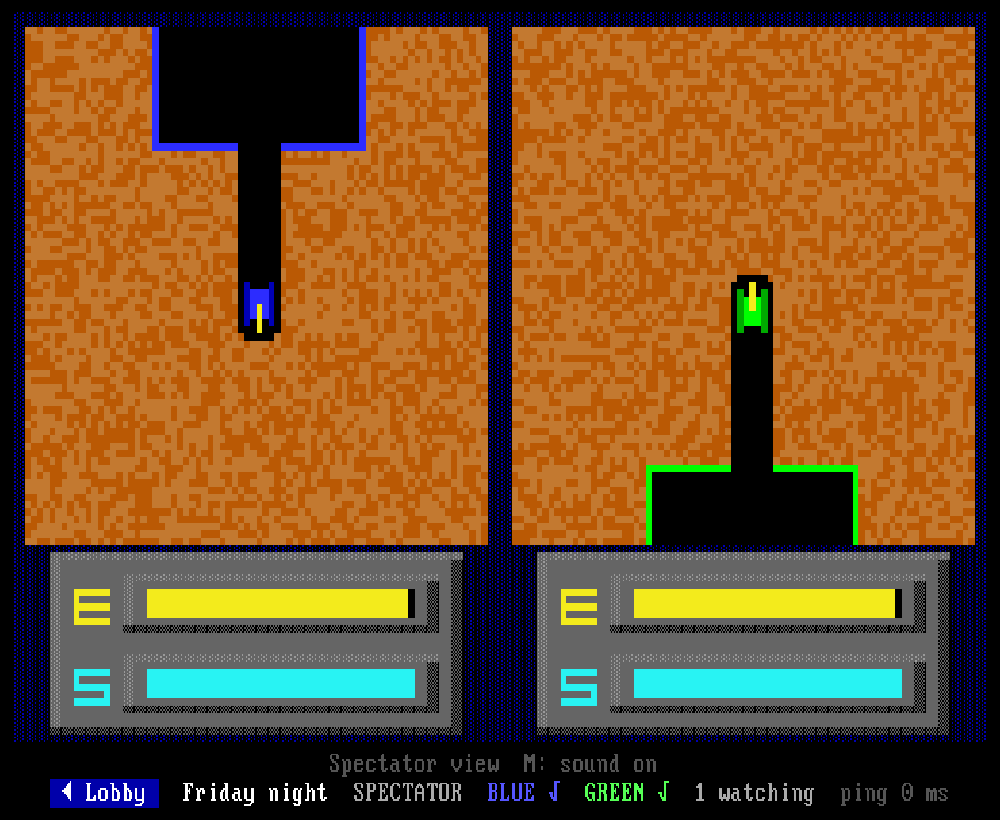

# TUNNELER ONLINE

**TUNNELER 2.0** - the 1991 DOS two-player tank game by Geoffrey Silverton - rewritten in JavaScript from
the decompiled original and playable in the browser: split screen, against the computer, or online
against a friend, with spectators.

**Play it now: <https://tunneler-online.onrender.com/>** - no install, just a browser. (Hosted on
Render's free tier: if nobody has played for a while, the first visit can take up to a minute while the
server wakes up.)


## Same game, same look

The original program was decompiled and ported routine by routine (`src/js/engine.js`). Tanks, digging,
shots, explosions, energy and shield, sound and the world generator behave exactly like the DOS game - an
automated test runs the original (compiled to WebAssembly) next to the port and compares every frame.

The screen is the original's undocumented "low-res" text mode (160x100 pixels in 16 colours, made of
80x100 text cells) on an emulated VGA with the IBM ROM font, and the sound is a simulated PC speaker.
All menus, the lobby and the status lines use the same DOS text screen.

| Split screen | Against the computer |
|---|---|
|  |  |

| Online lobby | Online: a player sees only their own screen | Spectator |
|---|---|---|
|  |  |  |

## Modes

- **Split screen** - two players on one keyboard, like the original.
- **Vs computer** - play BLUE against a computer-driven GREEN: easy, normal, hard or expert; see both
  screens or only your own.
- **Online game** - create a game in the lobby (public or private, with or without spectators), send
  the invite link, and play BLUE vs GREEN from two computers. Each player sees only their own view;
  spectators see both. The game starts when both players choose "Start game" and pauses while one of
  them is disconnected; reconnecting resumes where you left off.

Languages: English, Slovenčina, Čeština, Українська, Русский and Pirate (switch on the main menu).

## Controls

| | BLUE | GREEN |
|---|---|---|
| Move | W A S D | arrow keys |
| Fire | Left Ctrl, Left Shift, Space | Enter, Right Ctrl |

Online and against the computer you can use either set. Hold two direction keys to move diagonally;
firing while moving digs faster. **M** turns the sound on/off, **Esc** ends the match. Menus: arrow keys
and Enter, or the mouse.

The rules are in the game's own *Instructions* page: win three rounds; a round ends when a tank is shot
or runs out of energy; refuel at either base, repair your shield only at your own.

## Run it

```bash
npm install
npm run build      # src/ -> public/ (minified)
npm start          # http://localhost:8050  (PORT=... to change)
```

`npm run watch` rebuilds on every change and restarts the server. `npm test` runs all the checks.

### Hosting

The live version at <https://tunneler-online.onrender.com/> runs this repo's `Dockerfile` on
[Render](https://render.com) as a web service (port 8050, HTTPS and websockets handled by Render). Any
host that runs a Docker image or `npm run build && npm start` and allows websockets works the same way.
Games live in the server's memory, so a restart ends running games.

### Docker

```bash
docker build -t tunneler-online .
docker run -d -p 8050:8050 tunneler-online
```

Images are published to `ghcr.io/kaniansky/tunneler-online` (see `.github/workflows/docker-publish.yml`).
Put a reverse proxy (nginx, Caddy, ...) in front for HTTPS; the game connects its websocket over `wss:`
automatically when the page is served over HTTPS.

## How it works

- `src/js/engine.js` - the game: the whole DOS program as a deterministic state machine; one `step()` is
  one BIOS timer tick (54.9 ms, one game frame).
- `src/js/display.js`, `vgafont.js`, `speaker.js`, `input.js`, `runner.js` - emulated VGA text screen,
  PC speaker, keyboard, presentation loop.
- `src/js/dosui.js`, `statusline.js`, `home.js`, `lobby.js` - DOS-style menus and status lines.
- `src/js/lang.js`, `glyphs.js` - translations; letters the VGA font lacks are loaded from a VGA-style
  console font into unused font slots.
- `src/js/ai.js` - the computer player.
- `server.js`, `src/js/netproto.js`, `src/js/online.js` - online play: the server runs the game clock and
  broadcasts both players' keys every tick; every browser runs the same engine (lockstep), so only key
  presses travel over the network.

More detail for contributors in [CONTRIBUTING.md](CONTRIBUTING.md) and [CLAUDE.md](CLAUDE.md).

## Credits

TUNNELER 2.0 (1991) by Geoffrey Silverton, released by him into the public domain. TUNNELER ONLINE by
Norko Kaniansky, 2026 - also public domain ([Unlicense](LICENSE)).
