# Tunneler

**TUNNELER 2.0** - the 1991 DOS two-player tank game by Geoffrey Silverton - rewritten in JavaScript from
the decompiled original and playable in the browser: split screen, against computer tanks, or online with
up to 8 tanks, in teams, with spectators - plus quick play, a daily challenge with a leaderboard and a map editor.

**Play it now: <https://tunneler-online.onrender.com/>** - no install, just a browser. Online games need a
free account on the server (a username and a password); split screen and skirmish don't. (Hosted on
Render's free tier: if nobody has played for a while, the first visit can take up to a minute while the
server wakes up.)

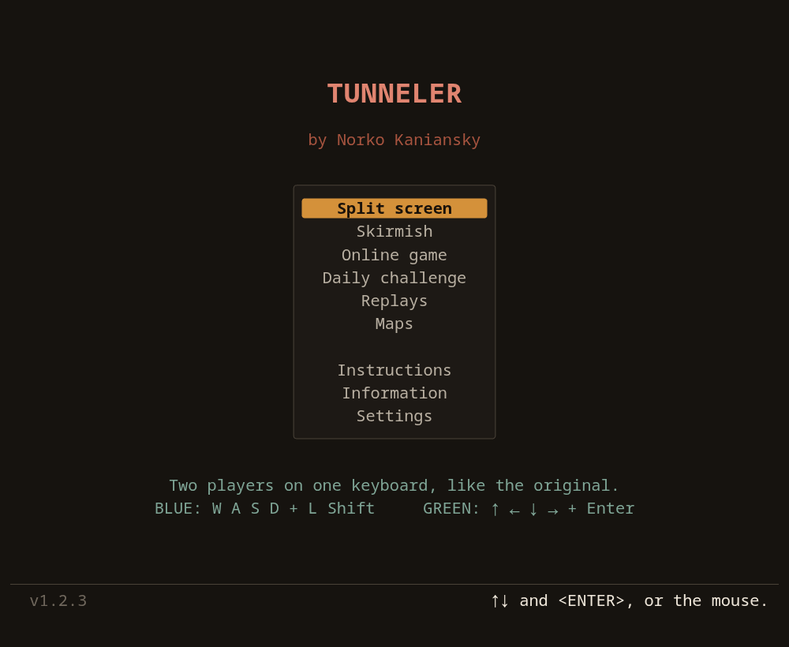

## Same game, same look

The original program was decompiled and ported routine by routine (`src/js/game/engine.js`). Tanks, digging,
shots, explosions, energy and shield, sound and the world generator behave exactly like the DOS game - an
automated test runs the original (compiled to WebAssembly) next to the port and compares every frame.
Two tanks (BLUE and GREEN) on the medium map, three rounds to win, is the original game byte for byte;
everything with more tanks, teams or other settings is built on top of it with the same physics.

The screen is the original's undocumented "low-res" text mode (160x100 pixels in 16 colors, made of
80x100 text cells) on an emulated VGA with the IBM ROM font, and the sound is a simulated PC speaker.
All menus, the lobby and the status lines use the same DOS text screen (or, with modern graphics, the same
screens drawn anew - see below).

| Split screen | Skirmish: the slot editor |
|---|---|
|  |  |

## What's new

New in 1.2:

- **3D** (Settings, Graphics, modern: **Depth 3D**): the world raised - dirt, rock and base walls with height,
  tunnels carved into the ground, tanks as 3D shapes with shadows - seen from straight above, so every view shows
  exactly what the 2D one does. Smooth tunnel edges give sculpted terrain; pixel edges (the retro style) voxels.
- **Generated maps**: the Map setting can be a world made anew for every match - **Fortresses**, **Arena**,
  **Highlands** or **Caves** - with a fair layout (symmetric) or a natural one, in skirmishes and online games.
  Teammates get bases near each other on every map. The map picker shows generated maps, your maps and the
  gallery, each with its picture; a new map in the editor can start from a generated world.
- **Smarter computer tanks**: they no longer park waiting for an enemy that left, hide behind a base's walls when
  low on energy or shield, refuel at the nearest base they may use, and find their way out of other tanks' bases.
- **Teammates marked**: a small triangle in their color over your teammates' tanks (Settings, Gameplay).
- **Replays when you want them**: "Save the replay" after a match (or Settings, Gameplay, Save every match); a
  replay plays in the version that recorded it.
- After death with one view, your left / right keys switch the teammate you watch; split screen's info shows your
  keys; the skirmish and online lobbies show the map.
- **Lamps that stop at walls** (1.2.4): a tank's lamp and headlight light its tunnel and the walls' faces, no longer
  through rock, base walls or dirt; the static at low energy is bright snow like the original's.
- **A quicker online game** (1.2.4): a frame from the server runs as soon as it arrives - your tank answers your keys
  up to 55 ms sooner -, an out-of-step page repairs itself without making the others rebuild, and the modern graphics
  send the GPU only what changed.
- **Debug info** (1.2.4, Settings, Gameplay): frame rate, drawing, the engine and the connection (ping, input lag,
  the frames waiting) in a small box at the top left.

| 3D: a team game on generated caves (the triangle marks your teammate) | The map picker: generated maps |
|---|---|
| 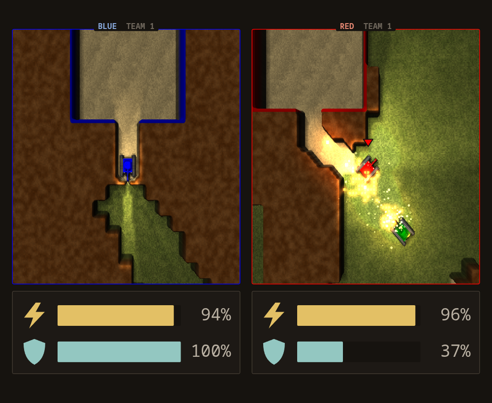 | 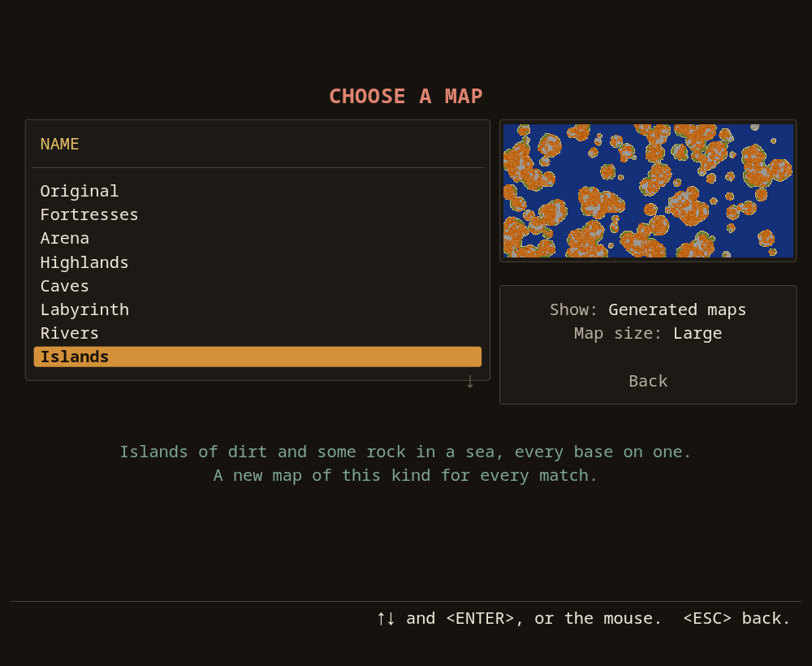 |

Earlier:

- **Quick play** (Online game, in the list of games): straight into an online game. The server finds a game with a
  place for you or makes one - eight tanks free-for-all, computer tanks in every seat nobody sits on, matches that
  start by themselves after a short countdown. Join a running match and you take over a computer tank at once;
  leave, and the computer drives it again.
- **Daily challenge** (main menu): every day (UTC) a new skirmish, the same for everyone - the same world, mode,
  map size and computer opponents. Play it as often as you like and send your result: the server plays the
  match's replay again with its own computer players, so only real results get on the day's leaderboard. Every
  entry's match can be watched, and the leaderboard goes back 30 days (play those days again as practice).
- **Your own maps** (main menu, Maps): paint rock, dirt and tunnels and place up to 8 bases on a small, medium or
  large map, with the keyboard, the mouse, a gamepad or a finger. Maps are kept in the browser, shared as links
  (`/map/<id>`) and saved as / opened from `.tmap` files, and played in a skirmish or an online game. A map is
  played only when a tank can drive between all of its bases - the editor says which can't be reached. The **map
  gallery** (Maps, Map gallery) lists the maps players published on the server - newest or most played, each with a
  picture -, and the Map setting opens a picker of your maps and the gallery's.
- **Player accounts**: online games and the daily challenge's leaderboard need an account on the game's server -
  a username (the name everybody sees, unique on that server) and a password, no e-mail. A recovery code, shown
  once, is the way to set a new password. A player is their account: a seat or tank comes back from any device,
  and nobody can play under another's name. Split screen, skirmish, replays, maps and looking at the daily
  challenge need none. (Servers can switch accounts off - see [Hosting](#hosting).)
- **Everything on every device**: logged in, your maps, replays and settings are kept with your account and come
  with you to every device you log in on - the browser, the desktop app or the Android app; a map or replay deleted
  on one goes on the others too.
- **The score mid-match**: hold **Tab** (SCORE on a touch screen, Back on a gamepad) for a box with the round,
  every player's or team's score and the game's settings.
- **Running reliably**: a server restart or deploy no longer ends online games (the server hands them to the
  next one, the pages reconnect and carry on); a dead connection is noticed within seconds and the page
  reconnects with its tank; a desync repairs itself.
- **Realistic** is the default sound style now.

The details are in [CHANGELOG.md](CHANGELOG.md) and [docs/v6/](docs/v6/).

| Quick play: two players, computer tanks in the other seats | The daily challenge's leaderboard | The map editor |
|---|---|---|
| 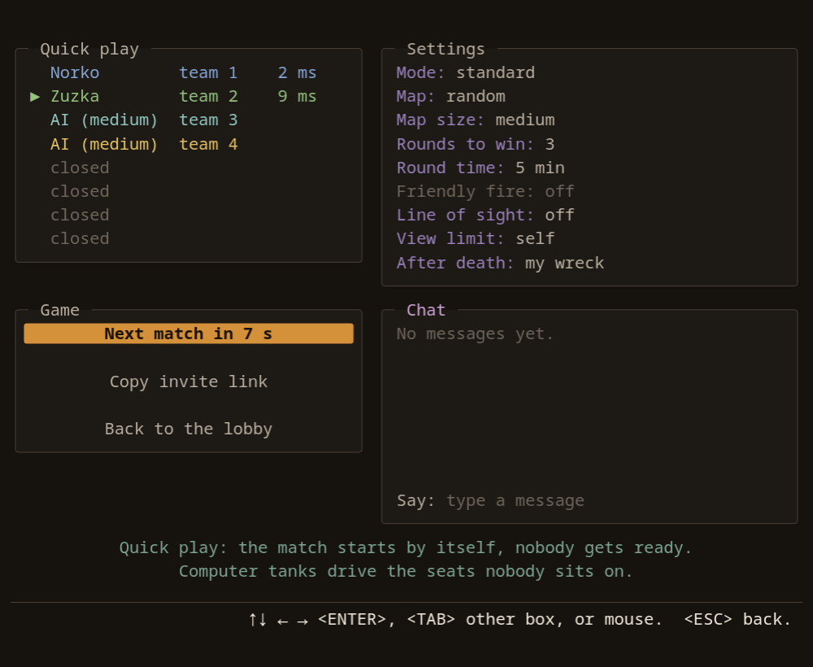 | 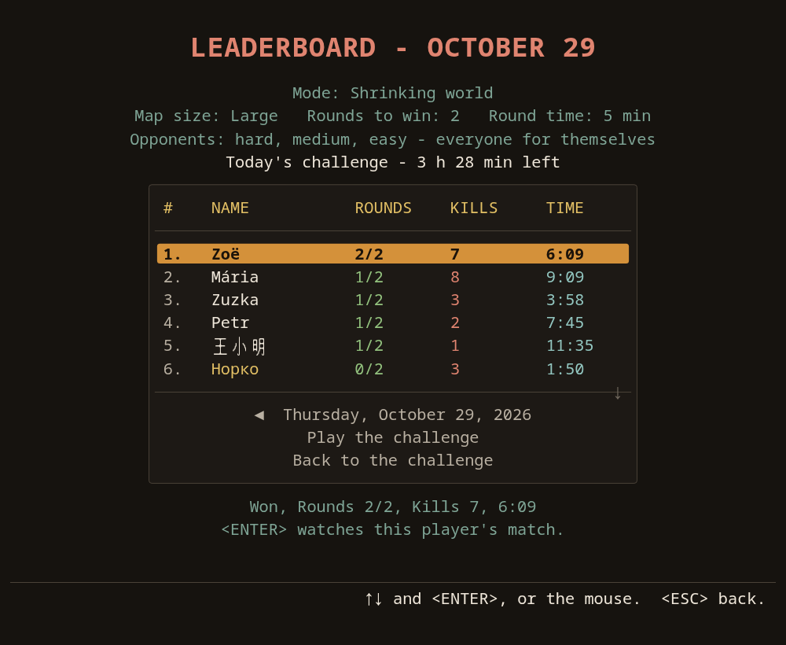 | 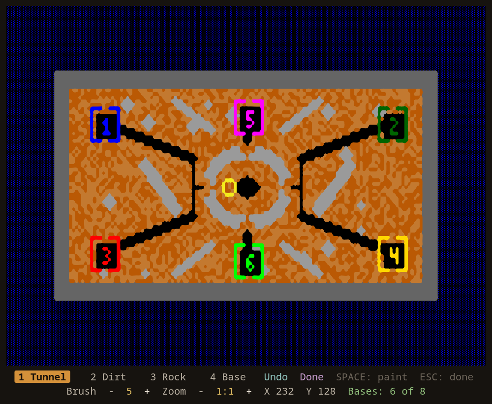 |

| Held Tab: the score mid-match (king of the hill, 4 tanks) |
|---|
| 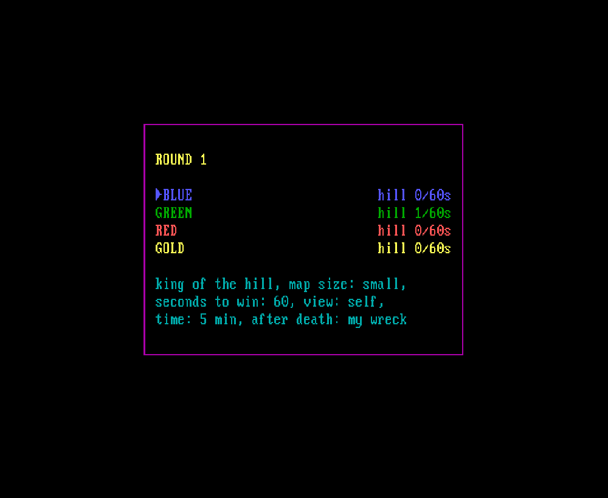 |

## Modern graphics

Settings, **Graphics: modern** draws the same game at your screen's resolution: smooth tunnels, textured
dirt and cracked rock, dark tunnels lit by the tanks' lamps and headlights (stopped by what's in the way), glowing shots, dust, sparks,
fire and debris, a smooth camera that glides with your tank, a new energy and shield panel, and every menu
in a modern font, flat and warm (no gradients, no glow). Its own settings screen picks a style (clean, or retro with chunky
pixels and the DOS colors) and quality, terrain, tunnel edges, lighting, particles, glow, screen shake,
camera, UI, the line of sight's fog of war and **depth: 3D or 2D** (1.2; 3D the default since 1.2.2). Only the look changes - the game, its rules and online
play stay exactly the same, and every player chooses their own look. **Modern** is the default since 5.0; **Original** is one switch away.

| Modern: its settings | Modern: a skirmish of four in 3D |
|---|---|
| 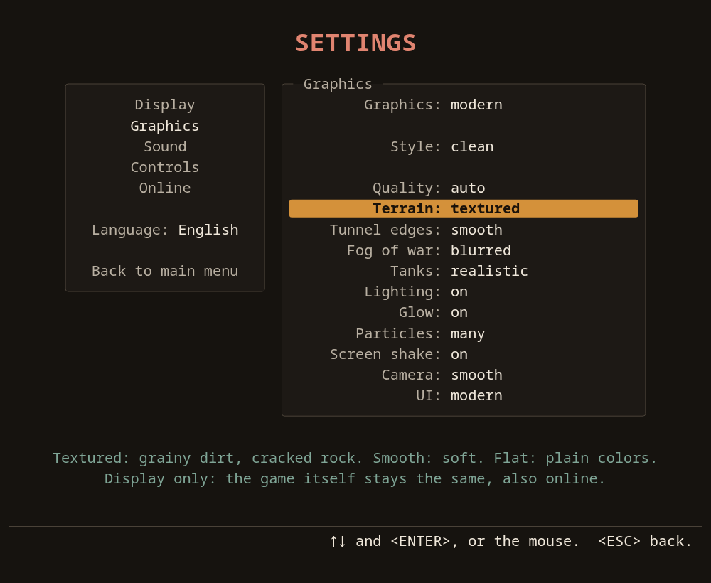 | 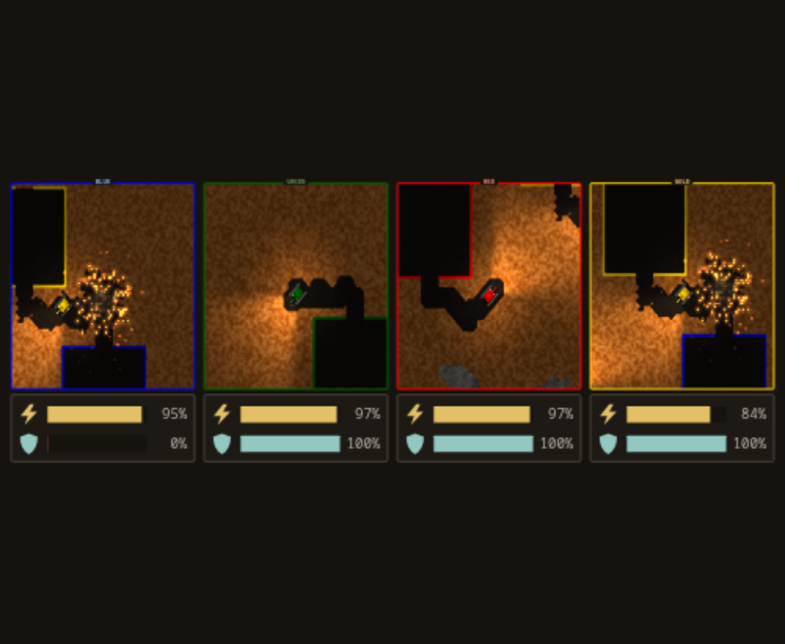 |
| **Modern, retro style: split screen** | **Original: the main menu** |
| 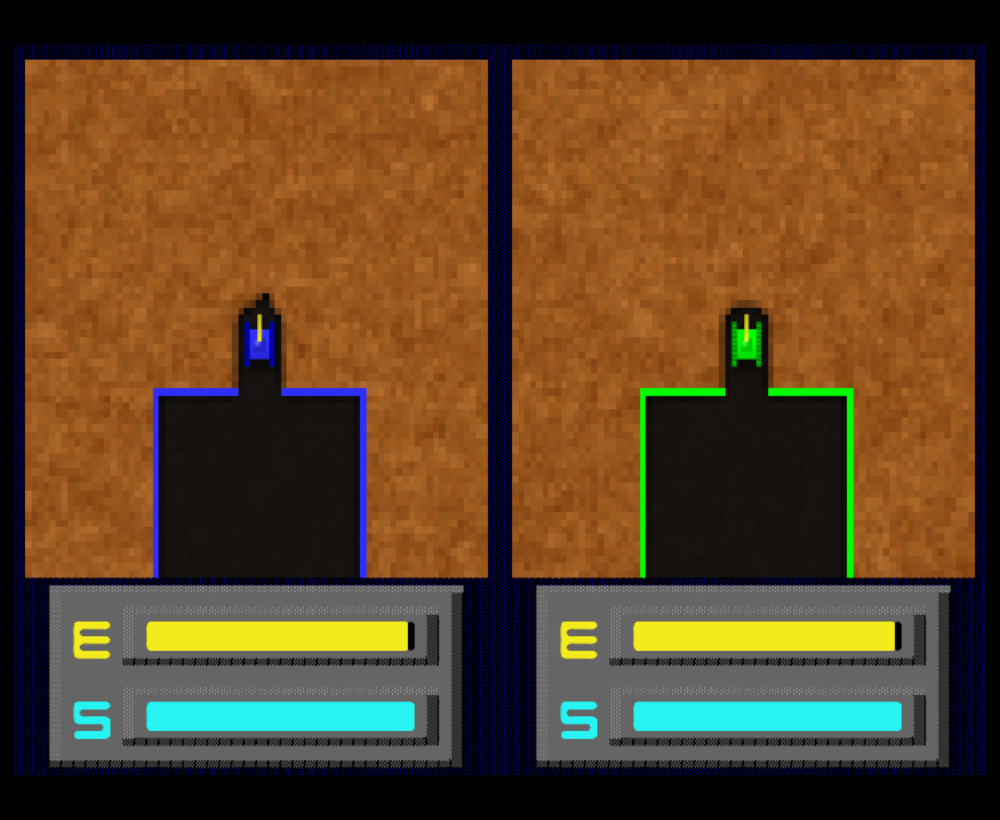 |  |
| **Original: the daily challenge** | **Original: the map editor** |
| 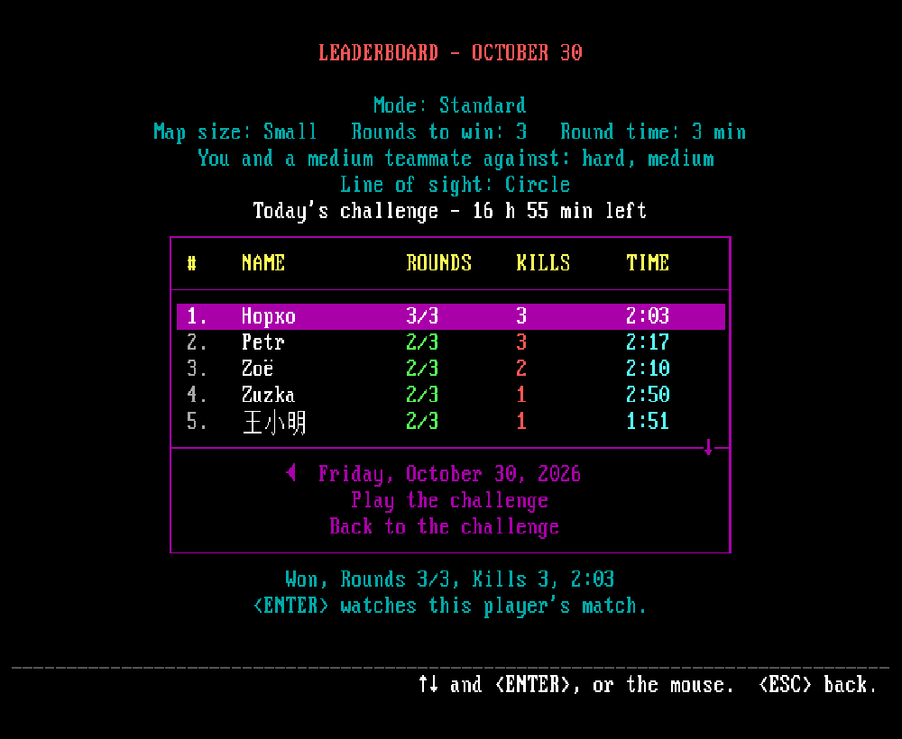 | 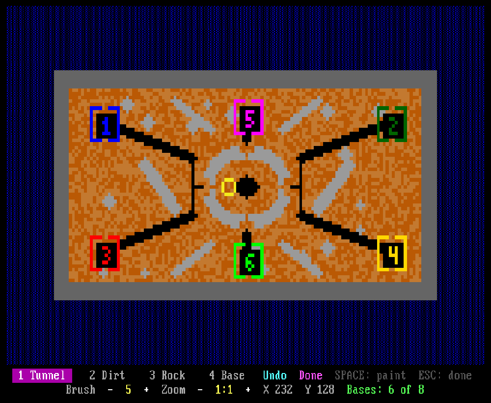 |

## Modes

- **Split screen** - two players on one keyboard, like the original.
- **Skirmish** - you (in any color) against 1 to 7 computer tanks (easy, medium or hard),
  every tank for itself or in teams. See your own screen, your team's screens or everybody's.
- **Quick play** - straight into an online game with computer tanks in the free seats (see above).
- **Online game** - create a game (public or private, with or without spectators, with an optional
  password), send the invite
  link (`/game/<name>`), and play with 2 to 8 tanks from several computers; any seat can be an AI tank.
  Addresses: `/games` (the list), `/game/<name>` (the game's lobby), `/game/<name>/watch` (spectating),
  `/split`, `/skirmish`, `/replays`, `/challenge`, `/maps`.
- **Daily challenge** - the day's skirmish, the same for everyone, and its leaderboard (see above).
- **Replays** - every match you play or watch is kept in the browser (the newest 20). Watch one again like a
  spectator (every view, the live map or one tank; pause, 1/2x to 8x, 30 s back / on), see its statistics,
  share it as a link (`/replay/<id>`: whoever opens it watches at once) or save it as a `.replay` file.

Game modes (skirmish and online; every mode's AI plays it too):

- **Standard** - the last tank (or team) still standing wins the round, as in the original.
- **Gold rush** - gold nuggets lie in the dirt: dig them up and bring them to your base; a hit makes you
  drop one. The most gold wins the round.
- **Infection** - one tank starts infected; tanks it destroys come back infected on its side. The healthy
  tanks win if any of them lasts until the time is up.
- **Survival** - all players together against waves of AI tanks that grow with every wave.
- **King of the hill** - hold the zone in the middle of the map alone to fill your bar.
- **Shrinking world** - the safe area closes in; outside it your shield melts away.
- **Capture the flag** - bring the enemy's flag to your base while yours is at home.
- **Base siege** - shoot the enemy bases down; the last side with a base wins.
- **Deathmatch** - destroyed tanks come back at their base; the first side to 10 kills wins.

Every mode but standard and shrinking world is a single round with its own goal instead of "rounds to
win": gold to win, minutes to survive, waves to win, seconds in the zone, captures, base strength (hits),
kills to win.

Settings (split screen: map size, rounds to win and round time only):

- **Slots and teams** - 8 slots (BLUE, GREEN, RED, GOLD, PINK, LIME, SKY, WHITE), each nobody,
  human or a computer tank (online: open, closed or AI), each with a team number 1-8: all different =
  free-for-all, shared numbers = teams of any size (4 v 4, 2 v 2 v 2 v 2, 3 v 5, ...).
- **Map size** - small (512x256), medium (1024x512, the original) or large (2048x1024).
- **Map** - random (the original's world generator), one of your own maps or one from the server's map gallery
  (skirmish and online).
- **Rounds to win** - 1 to 9 (the original: 3).
- **Round time limit** - off, 2, 3, 5 or 10 minutes. When the time is up, the side that hit enemy tanks
  the most wins the round (a tie: nobody); the last 30 seconds count down next to the instrument panel.
- **Friendly fire** - on or off in team games (off: a shot at a teammate explodes like on a wall).
- **Line of sight** - off (the original), circle (each tank sees the world live only in a circle around it;
  the rest of its view is the world as that player last saw it, in gray - an enemy stays where you saw it
  last) or true (dirt, rock and base walls also hide what is behind them: in a tunnel you see only the
  tunnel). Computer tanks see the same way.
- **View limit** - the most a player may see during play: their own view, their team's or everybody's.
- **After death** - what you see once your tank is destroyed, until the round ends: a black DESTROYED
  screen, your wreck (the original), all your teammates still alive, the tank that destroyed you (then
  its killer, ...) or every tank still alive (then only those - your own destroyed view goes); nobody left
  to watch - black. Except with "my wreck", a destroyed teammate's view goes black too.

The homepage's **Settings** screen holds your account for online games (Online: log in or out, change the
password, delete the account), the language, the **sound** - muted, original (the PC speaker),
realistic (the default), recorded or cartoony (a sample plays when you change it) - **Smooth scrolling** (on by default: the original
moves the view sideways 2 pixels at a time - its screen mode holds two pixels per byte - so it stutters a
little when you drive left or right; on, the view follows 1 pixel at a time; only the picture changes, not
the game) - and **Show ping** (your round-trip time as
a small number on the game's border online). Sounds of other tanks fade with their distance from the
tank you watch and come from their side, in stereo (split screen: left near BLUE, right near GREEN).

| Create a game | The game's lobby: seats, teams, settings, chat |
|---|---|
| 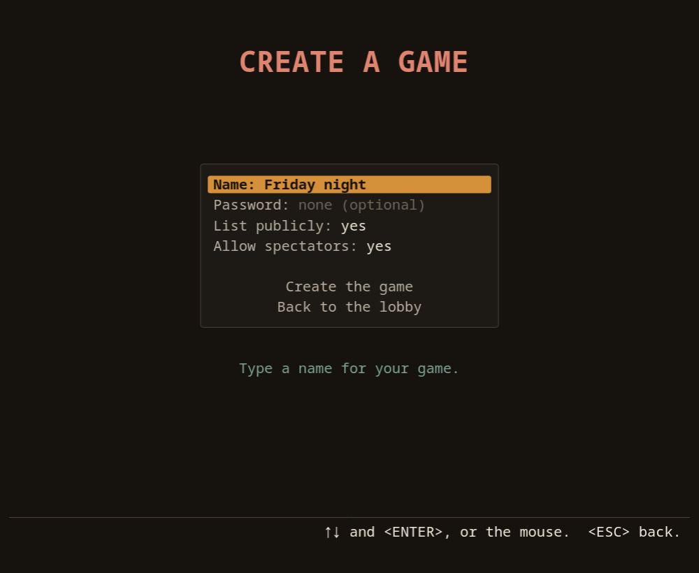 | 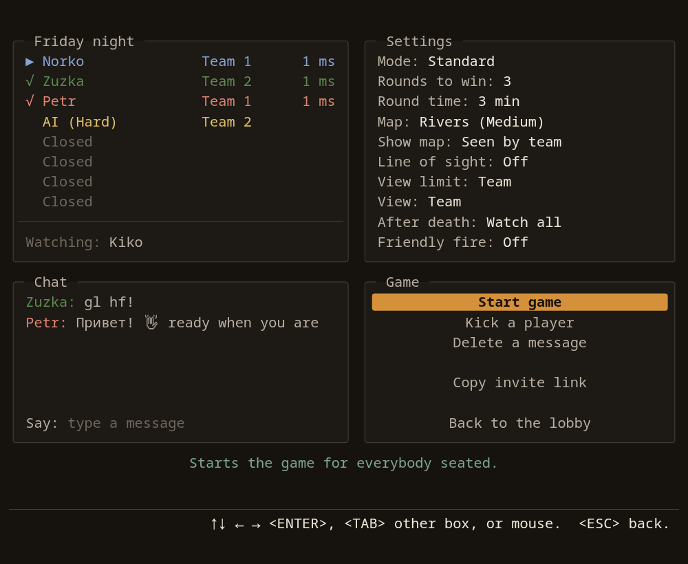 |

### Online

Online play needs an account on the server: the games list, quick play and an invite link ask you to log
in or create one first (LOG IN / CREATE AN ACCOUNT), then go on where you were going; your username is the
name everybody sees. Every game
has a **lobby** with 8 seats, one per color, each row in its color: a player's name (a √ in front once
ready), **open**, **closed** or **AI** (easy, medium, hard), the team and the ping. Joining a game takes
a free open seat (else you watch; a quick-play game: a computer tank's seat, even during a match); sit on another open seat to play that color, change your team with
Left / Right, 1-8 or a click, chat with players and spectators (any alphabet), choose **I am ready!** (a click on your
name leaves the seat to watch).
The creator of the game is its **host** (when the host leaves, the next player takes over): a click (or
Left / Right) steps every seat nobody else sits on through closed, open, the host's own seat (while they
sit nowhere else) and AI (easy, medium, hard), a right click goes back; they also set its team, change
the game's settings, **Kick a player** (who then can't come back - their chat messages show as *deleted*),
**Delete a message** from the chat and **Start game** once everybody
seated is ready. Open seats nobody took get no tank. (A quick-play game has fixed settings, no "ready": its
next match starts by itself after a countdown.) During a match only its players play - whoever
joins then watches; afterwards everyone is back in the lobby, with the statistics of the last match.
The list of games shows each game's mode, players, AI tanks, spectators and state; Enter joins, Right or
a right click watches. Games you host come first (your private ones too).
A game with a password (a lock in the list) asks for it before you join or watch; its host never needs
it. A private game is joined with its invite link: open it, or paste it into **Join by link** on the
list of games (the desktop app then also switches to that link's server). Only the same version of the
game plays together: a page or desktop app of another version than the
server's can't join or create games there (it says which versions differ).

During play each player sees only their own view screen - or their team's or everybody's, as far as the
game's view limit allows. A disconnected player's tank stands still and the game goes on;
reconnecting resumes where you left off. (A classic BLUE vs GREEN game pauses instead, like before.)

| An 8-tank game: BLUE sees its team | Spectator: all views | Spectator: map and scores |
|---|---|---|
| 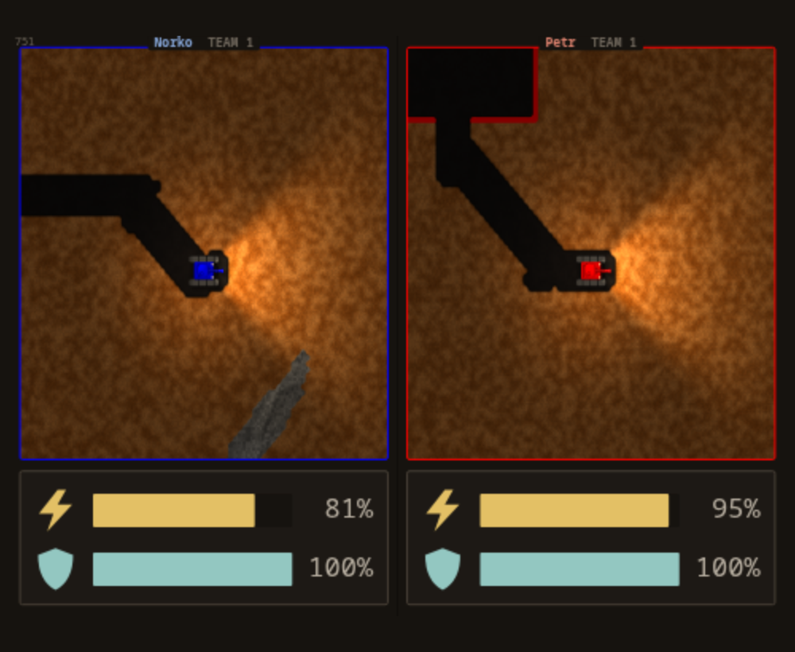 | 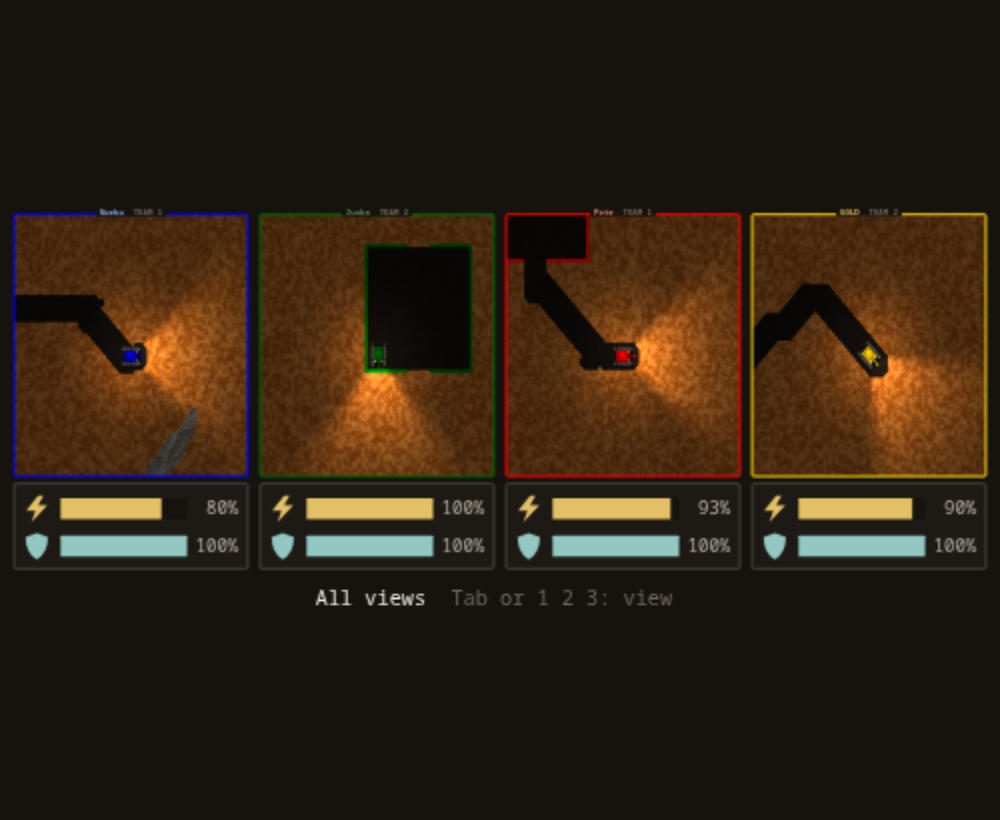 | 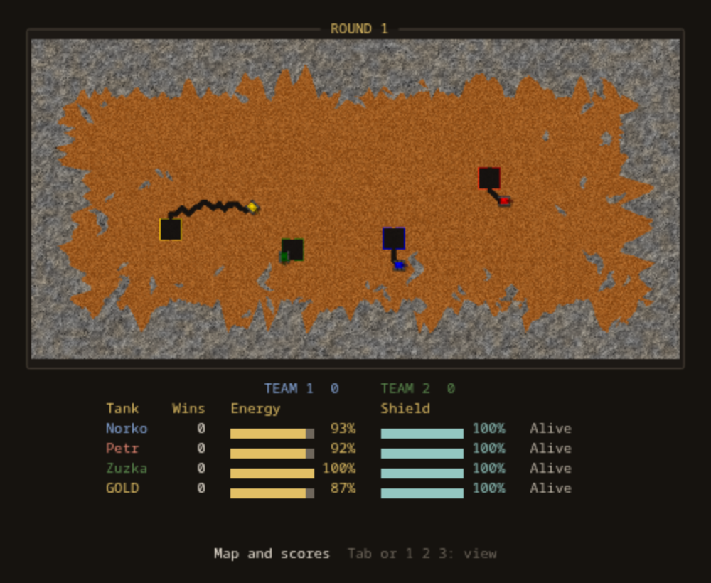 |

**Spectators** switch between three views with Tab or 1 2 3: all view screens in a grid, the live map of
the whole world with a score table (wins, energy, shield per tank and team), or one tank followed large
(Left / Right choose the tank).

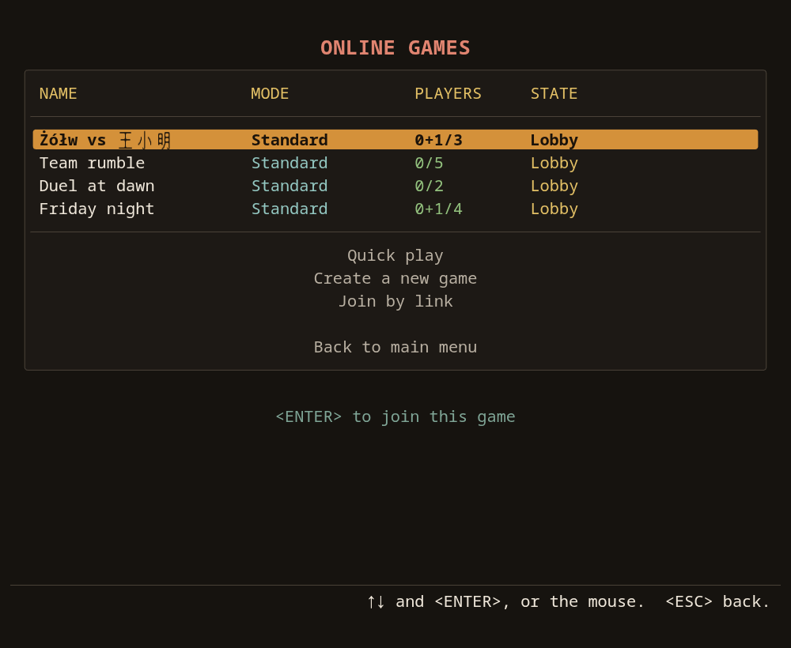

Languages: English, Slovenčina, Čeština, Українська and Русский (on the Settings screen, or
`?lang=sk` / `cs` / `uk` / `ru` / `en` in the address). Each language is one folder in `src/lang/`.
The homepage, https://kaniansky.com/tunneler/, comes in the same languages.

## Controls

| | BLUE | GREEN |
|---|---|---|
| Move | W A S D | arrow keys |
| Fire | Left Shift, Space | Enter, Right Shift |

Online and against the computer you can use either set. Hold two direction keys to move diagonally;
firing while moving digs faster. Hold **Tab** for the score (players; a spectator's Tab switches the views). The keys can be changed in
Settings, Controls; after death with one view, your left / right keys watch the next teammate.
**Esc** ends the match on one computer; online, **Esc twice** leaves the
game (one player can't end it for everybody). Menus: arrow keys and Enter, number keys 1-8 for teams, or
the mouse (clicks, the wheel in long lists); Esc goes back.

**Gamepads** work too: the left stick or the d-pad drives the tank in 8 directions, A / B / X / Y, the
shoulder buttons and the triggers fire, Start is Esc, Back / Select shows the score. In split screen the first gamepad is BLUE and the
second GREEN (the keyboard still works); against the computer and online any gamepad drives your tank.
In menus the d-pad moves, A selects, B goes back.

**Phones and tablets**: touch the screen and an on-screen joystick (left) and a FIRE button (right)
appear, plus ESC and SCORE (held: the score) buttons; they drive your tank (BLUE in split screen). Tap menu items to choose them.
The game fits the screen in portrait and landscape.

The rules are in the game's own *Instructions* page: win the set number of rounds (three in the
original); a round ends when only one tank (or one team) is left - tanks blow up when shot or out of
energy; refuel at any base, repair your shield at your own (and, at half the speed, at a teammate's).

## Run it

```bash
npm install
npm run build      # src/ -> public/ (minified)
npm start          # http://localhost:8050  (PORT=... to change)
```

`npm run watch` rebuilds on every change and restarts the server. `npm test` runs all the checks.

### Desktop app

Every [release](https://github.com/kaniansky/tunneler/releases) has a small desktop app: the game
in its own window, using the web view the system already has (a few MB, no browser needed).

| System | File | Needs |
|---|---|---|
| Windows 10 / 11 | `-windows-x64-setup.exe` (installer) or `tunneler-<version>-windows-x64.exe` (just run it) | WebView2 (built in) |
| Linux | `tunneler-linux-x64.AppImage` (`chmod +x` first; always the newest: <https://github.com/kaniansky/tunneler/releases/latest/download/tunneler-linux-x64.AppImage>), `.deb`, `.rpm` (or the repositories below), or the bare binary in `-linux-x64.tar.gz` | `libwebkit2gtk-4.1` |
| macOS | `-macos-arm64.dmg` (Apple silicon) / `-macos-x64.dmg` (Intel) | not signed: right click -> Open the first time |

When a newer release is out, the app's main menu shows **Update to version X**: the installed Windows
app, the AppImage and the macOS app download it, install it and restart; the `.deb` / `.rpm` do the same
after asking for the admin password; the portable exe and the `.tar.gz` show **New version X**, which
opens the download page. A downloaded AppImage has to be made executable once (`chmod +x
tunneler-linux-x64.AppImage`, or Properties -> Allow executing as a program) - browsers never keep
that. Its name has no version: an update writes the new version over the same file, so shortcuts keep
working (the main menu's bottom-left corner shows the version).

On Linux the game can also come from its own **apt / dnf repository** and then updates with the rest of
the system (signed with the key at <https://kaniansky.com/tunneler/tunneler.asc>):

```bash
# Debian, Ubuntu, Mint
curl -fsSL https://kaniansky.com/tunneler/tunneler.gpg | sudo tee /usr/share/keyrings/tunneler.gpg >/dev/null
echo "deb [signed-by=/usr/share/keyrings/tunneler.gpg] https://kaniansky.com/tunneler/apt ./" | sudo tee /etc/apt/sources.list.d/tunneler.list
sudo apt update && sudo apt install tunneler

# Fedora and other dnf systems
sudo curl -fsSL -o /etc/yum.repos.d/tunneler.repo https://kaniansky.com/tunneler/rpm/tunneler.repo
sudo dnf install tunneler
```

On any distribution the game is on [Flathub](https://flathub.org/apps/com.kaniansky.Tunneler), where software
managers such as GNOME Software, KDE Discover and Linux Mint's find it; it updates through them, not through the app:

```bash
flatpak install flathub com.kaniansky.Tunneler
```

The Flatpak (`flatpak/`, app id `com.kaniansky.Tunneler`) is the release's `.deb` on the GNOME runtime. To build and
install it yourself:

```bash
flatpak install --user flathub org.flatpak.Builder org.gnome.Sdk//51
flatpak run org.flatpak.Builder --user --install --force-clean build-dir flatpak/com.kaniansky.Tunneler.yml
flatpak run com.kaniansky.Tunneler
```

Split screen and skirmish work offline. Online play goes to the public server; to play on your own,
set **Server** on the homepage's Settings screen (e.g. `example.com:8050`, empty = the public one). The
app is built by `.github/workflows/app-build.yml` from `src-tauri/` ([Tauri](https://tauri.app)); to
build it yourself: install Rust and the [Tauri prerequisites](https://tauri.app/start/prerequisites/),
then `npm run build && npx @tauri-apps/cli@2 build`.

### Hosting

The live version at <https://tunneler-online.onrender.com/> runs this repo's `Dockerfile` on
[Render](https://render.com) as a web service (port 8050, HTTPS and websockets handled by Render). Any
host that runs a Docker image or `npm run build && npm start` and allows websockets works the same way.
Render's free plan stops a service after 15 minutes without requests; the server keeps itself awake by asking its own
public address (`RENDER_EXTERNAL_URL`, which Render sets, or `KEEP_AWAKE_URL`) for `/api/health` every 10 minutes
(`KEEP_AWAKE=0` turns that off).
Games live in the server's memory. When the server is stopped with SIGTERM (a deploy, a restart), it first
writes every game (lobbies and running matches) to its state store (below). The next server reads them back, and the
players' pages reconnect and carry on. Without a bucket or a writable folder for it, a restart ends running games.
`GET /api/health` answers `{ok, version, uptime, rooms, matches, errors}`, and pages report the errors they catch to
the server's log (`client error ...`) and keep them grouped (`ERRORS_TOKEN`, below).

**Where the server keeps things.** Six kinds of data, each on its own:

| kind | what | bucket variable | folder |
|---|---|---|---|
| replays | shared replays (Share a link; the daily leaderboards' matches) | `S3_BUCKET_REPLAYS` | `DATA_DIR/replays` |
| maps | shared maps (Share a link, maps chosen for online games) and the map gallery's index | `S3_BUCKET_MAPS` | `DATA_DIR/maps` |
| accounts | player accounts (and the maps, replays and settings kept with them) | `S3_BUCKET_ACCOUNTS` | `DATA_DIR/accounts` |
| challenges | the daily challenge's leaderboards (`<day>.json.gz`) | `S3_BUCKET_CHALLENGES` | `DATA_DIR/challenges` |
| state | the games handed over on a restart | `S3_BUCKET_STATE` | `DATA_DIR/state` |
| errors | the pages' (and the server's) error reports, grouped | `S3_BUCKET_ERRORS`, else the state's bucket | `DATA_DIR/errors` |

- An **S3-compatible bucket** per kind - Cloudflare R2 (10 GB free), MinIO, AWS S3 - with one set of keys:
  `S3_ENDPOINT` (R2: `https://<account id>.r2.cloudflarestorage.com`), `S3_ACCESS_KEY`, `S3_SECRET_KEY`,
  `S3_REGION` (R2: `auto`, the default), and the kind's bucket variable. For R2: create the buckets, then one R2 API
  token with "Object Read & Write" for them - its Access Key ID and Secret Access Key are the two keys.
- A kind without a bucket goes to its folder in `DATA_DIR` (default `data/` next to server.js; the Docker image uses
  `/app/data`, docker-compose.yml mounts a volume there). Without a writable folder: the server's memory (lost on a
  restart).
- Each bucket gets the rules its kind wants. **Replays**: R2's Settings -> Object lifecycle rules -> "Delete objects"
  after N days, and `REPLAY_KEEP_DAYS` set to the same N (whoever shares one is told how long the link works; the folder
  deletes older files itself, and keeps the newest 5000). **Challenges**: optional - only the last 30 days are ever
  read. **Maps, accounts, state: no rule** - a bucket keeps maps for good (the folder keeps the newest 5000, the
  gallery's maps always), and an account deleted by a rule is lost.

The map gallery: a published map can be removed by its author, or by anyone sending the header `X-Admin-Key: <key>`
when the server has `GALLERY_ADMIN_KEY=<key>` (`curl -X POST -H "X-Admin-Key: <key>" <server>/api/gallery/<id>/remove`;
make the key long and random, e.g. `openssl rand -hex 32`). An address may publish 50 maps a day.

The server's log says where each kind is kept at start (`shared replays: ...`, `shared maps: ...`, `daily challenge
leaderboards: ...`, `rooms on a restart: ...`, `accounts: ...`). The live server uses R2 buckets: Render's free disk is
wiped on every deploy (and its new instance starts before the old one stops - the state needs a bucket).

**Player accounts** (docs/v6/ACCOUNTS.md): online games and daily-challenge results need an account on the server
(a username and a password - no e-mail; a recovery code is the way back in). Set by environment variables:

- `ACCOUNTS=off` - no accounts: free player names as before (a LAN game, a server for friends). Default: on.
- `ACCOUNT_SECRET` - the key that signs the players' login tokens (any long random string). Without it the server
  makes one at its first start and keeps it with the accounts; set it to be independent of the store.
- `ERRORS_TOKEN` (optional) - turns on reading the kept error reports: `curl -H "Authorization: Bearer $ERRORS_TOKEN"
  "<server>/api/errors?since=2026-01-01T00:00:00Z&version=1.2.1"` (JSON, newest first; `DELETE /api/errors/<key>`
  clears a group). Without it the endpoint answers 404 (reports are still kept).
- `GOOGLE_CLIENT_ID` / `GOOGLE_CLIENT_SECRET` (optional) - the Play Games project's web OAuth client: the Android
  app's "Sign in with Google Play" (docs/v6/ACCOUNTS.md section 6). Without them that option isn't offered.
- Where accounts are kept: `S3_BUCKET_ACCOUNTS`, else `DATA_DIR/accounts`, else memory (lost on a restart:
  development only) - see above; never a bucket with a lifecycle rule.

Behind a reverse proxy (Render, a CDN, nginx) set `TRUST_PROXY`, or the per-address limits of logins and sign-ups
count every player as one address: `1` = the last `X-Forwarded-For` entry, a number n = the n-th entry from the right
(several proxies in a row), or the name of a header the edge proxy sets (e.g. `true-client-ip`). On Render use
`TRUST_PROXY=cf-connecting-ip` (Cloudflare in front sets it; the last `X-Forwarded-For` entry is Render's own hop). Check it with
`/api/health?addr=1`: `you` is the address the server sees for you, `fwd` your forwarding headers. The log says it at start (`accounts: on, kept in ...`). Passwords and recovery codes are kept only as scrypt
hashes; players delete their accounts in the game (Settings, Online).

### Docker

The easiest way is Docker Compose with the published image (`docker-compose.yml` in this repo):

```bash
docker compose up -d                            # http://localhost:8050
TUNNELER_PORT=80 docker compose up -d           # another port on the host
docker compose pull && docker compose up -d     # update to the latest release
docker compose up -d --build                    # build from this checkout instead
```

Or plain Docker:

```bash
docker run -d -p 8050:8050 --restart unless-stopped ghcr.io/kaniansky/tunneler:latest
docker build -t tunneler . && docker run -d -p 8050:8050 tunneler   # from source
```

Games live in the server's memory; a restart hands them over through the replays' folder (docker-compose
keeps it in a volume), so running games carry on (see [Hosting](#hosting)). A game nobody plays in for 10
minutes is closed automatically. Players need an account on your server unless you start it with
`ACCOUNTS=off` (see [Hosting](#hosting) for `ACCOUNT_SECRET` and where accounts are kept).

The server checks GitHub for a newer release when it starts and once a day, and logs a line when one is
out (`UPDATE_CHECK=0` turns that off; nothing is downloaded).

Every release (a pushed version tag) publishes the Docker image to `ghcr.io/kaniansky/tunneler`
(`latest` and the version; see `.github/workflows/release.yml`).
Put a reverse proxy (nginx, Caddy, ...) in front for HTTPS; the game connects its websocket over `wss:`
automatically when the page is served over HTTPS.

## How it works

One page (`src/index.html`), its screens are routes (`src/js/app.js`: the main menu, the games list, an online
game, a local game - each loaded when first shown); the code is ES modules, bundled by `node build.js`
(esbuild) into `public/`. The server needs Node.js 20.19 or newer.

`src/js/` by folder: `game/` the game itself (engine, computer tanks, modes, maps, replays, the daily challenge, the
online protocol), `draw/` what is drawn (the game's picture, the match's text, the screen, the views, the two looks),
`ui/` menus and pages, `routes/` the screens (main menu, local game, games list, online game, replays, maps, daily
challenge), `text/` languages, Unicode and fonts, `io/` keyboard, gamepads, touch, sound, the clock, the screen
size, `net/` the server's address, accounts, shared maps, error reports; `app.js`, `nav.js`, `scope.js`,
`version.js` at the top.

- `src/js/game/engine.js` - the game: the whole DOS program as a deterministic state machine; one `step()` is
  one BIOS timer tick (54.9 ms, one game frame). The classic two-tank game runs the original code paths
  unchanged; 3-8 tanks, teams and the other settings run the engine's *extended mode* (design:
  [docs/DESIGN-8P.md](docs/DESIGN-8P.md)).
- `src/js/draw/display.js`, `text/vgafont.js`, `io/speaker.js`, `io/input.js`, `io/runner.js` - emulated VGA text screen,
  PC speaker (sounds fade with distance), keyboard, presentation loop.
- `src/js/ui/dosui.js`, `draw/statusline.js`, `routes/home.js`, `routes/lobby.js` - DOS-style menus, slot editors and status
  lines.
- `src/js/draw/views.js` - what a viewer sees during play: one view screen, a grid of several, or the live
  map with scores.
- `src/js/text/lang.js` (core), `src/lang/<code>/` (one folder per language: `main.js`, a file per game mode in `modes/`, and
  `en/engine.js` the engine's English text; `src/lang/index.js` imports them all),
  `glyphs.js` - translations; letters the VGA font lacks are loaded from a VGA-style console font into
  unused font slots, and names and chat in the lobby are drawn in any alphabet.
- `src/js/game/ai.js` - the computer tanks: deterministic, so every browser runs the same ones.
- `server.js`, `src/js/game/netproto.js`, `src/js/routes/online.js` - online play: the server runs the game clock and
  broadcasts every player's keys each tick; every match is its own game (new seed, the lobby's tanks,
  names and settings); every browser runs the same engine and computer tanks (lockstep), so only key
  presses travel over the network.

More detail for contributors in [CONTRIBUTING.md](CONTRIBUTING.md) and [CLAUDE.md](CLAUDE.md).

## Credits

TUNNELER 2.0 (1991) by Geoffrey Silverton, released by him into the public domain. Tunneler by
Norko Kaniansky, 2026 - also public domain ([Unlicense](LICENSE)). The fonts and glyph data come from
third parties under their own licenses: see [NOTICE](NOTICE).
